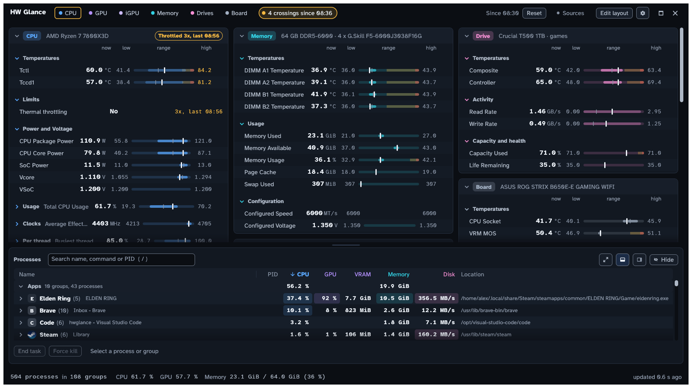
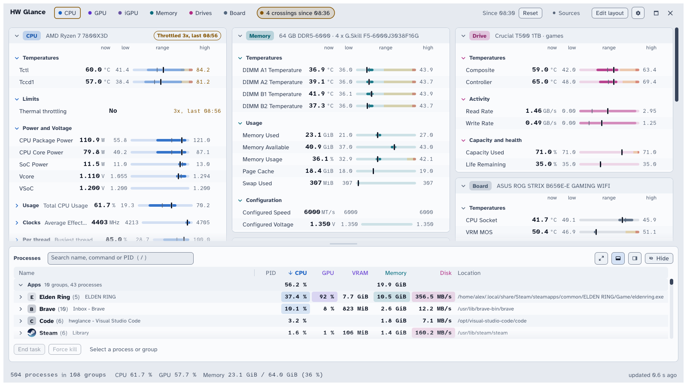
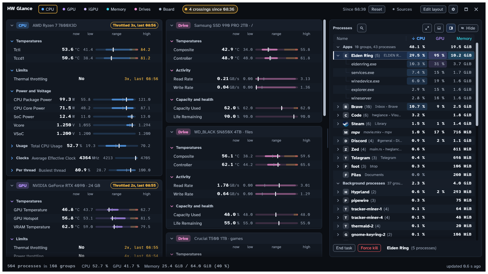

<p align="center">
  
</p>

# HW Glance

Every sensor on your Linux desktop and a Task Manager style process list, in one window.

HW Glance shows the readings your machine exposes (CPU, GPU, memory, drives, motherboard) in per-device cards, so you can find one in about a second. A background collector records every reading; the window and an optional bar widget read from it.



The screenshots use built-in demo data.

## What it does

- **Device cards** for the CPU, GPU, memory, each drive, the motherboard and an integrated GPU. Each reading shows current, min, max and average, a range bar, and a 30 minute history on hover.
- **Limits and alerts.** Warning and critical limits mark a reading with a colour and a flag letter (H, HH, L, LL) and send a desktop notification. You can edit them in [`thresholds.json`](#limits-thresholdsjson).
- **Throttling.** CPU and GPU cards show thermal and power throttling as Yes/No, with a count and the last event's time.
- **Processes** grouped as Apps, Background and System, sortable by CPU, GPU, VRAM and memory, with per-process GPU use. The panel docks at the bottom or the right, compact or expanded.
- **Safe actions.** End task sends a normal exit request at once. Force kill, and any process critical to the session (compositor, audio server, the collector), asks first. Other users' processes go through polkit.
- **Resets act at once.** The reset button then reads Undo for 30 seconds, and Ctrl+Z takes back the latest reset.
- **Your layout.** Watch, hide or rename readings, drag cards into place, and pick dark or light themes that follow the desktop. The top bar has its own Maximize and Close buttons.
- **Text readouts** (opt-in) for status bars, scripts and macro keypads: see [Text readouts](#text-readouts).
- **Light.** The collector and the window each stay well under 2% of one core.

| Light theme | Process panel docked on the right |
|---|---|
|  |  |

## What you need

Required: Linux with systemd (the collector is a systemd user service) and a Wayland or X11 session with OpenGL. Building from source also needs Rust 1.95 or newer and the Wayland, X11 and OpenGL development packages (`.github/workflows/ci.yml` lists the Debian names).

Optional, each adds readings or features:

| Component | What it adds |
|---|---|
| NVIDIA driver (NVML) | GPU load, temperature, clocks, VRAM, power and fan |
| [LACT](https://github.com/ilya-zlobintsev/LACT) daemon | GPU hotspot and VRAM temperatures, fan RPM and core voltage (the NVIDIA driver hides them on Linux) |
| The root helper (`hwglance-helper`, installed by default) | CPU package power (RAPL) and memory speed and modules (SMBIOS), which only root can read |
| Board hwmon drivers (`nct6775`, `asus-ec-sensors`) | Motherboard temperatures and fans |
| `notify-send` (libnotify) and a notification daemon | Notifications when a limit is crossed |
| Hyprland | Window titles in the process list, and the maximized state |
| Omarchy | The bar widget, the theme and font, and the notification's Open button |
| polkit (`pkexec`) | Ending other users' processes |
| An Arabic font | Arabic window titles and process names |

## Install and uninstall

Pick one. All three set up the same two programs, `hwglance` (the window) and `hwglanced` (the collector).

**Arch Linux package.** Download `hwglance-<version>-1-x86_64.pkg.tar.zst` from the [latest release](https://github.com/Raed-Alghamdi/hwglance/releases/latest), then:

```sh
sudo pacman -U hwglance-0.1.0-1-x86_64.pkg.tar.zst
systemctl --user enable --now hwglanced
sudo systemctl enable --now hwglance-helper   # optional, see below
hwglance-bar-widget install                   # Omarchy only
```

The package installs system-wide and starts nothing itself. After an upgrade run `systemctl --user restart hwglanced` and `hwglance-bar-widget update`. An AUR package is planned. To remove it, run `systemctl --user disable --now hwglanced` and `hwglance-bar-widget remove` (as your user), then `sudo pacman -R hwglance`.

**Generic x86_64 Linux tarball.** Download `hwglance-<version>-x86_64-linux.tar.gz` from the release (a `.sha256` file sits beside it), then:

```sh
tar -xzf hwglance-0.1.0-x86_64-linux.tar.gz
cd hwglance-0.1.0-x86_64-linux
./install.sh
```

It holds prebuilt binaries (built on Ubuntu, so it needs a glibc of that age or newer) and needs no Rust. It installs per user, like the source install below, and `./uninstall.sh` reverses it.

**From source.**

```sh
git clone https://github.com/Raed-Alghamdi/hwglance.git
cd hwglance
packaging/install.sh
```

The script builds release binaries at low priority and installs:

- `hwglance` and `hwglanced` in `~/.local/bin`, a desktop entry and the app icon (SVG, and PNG from 16 to 512 px);
- the collector's systemd user service, enabled and started;
- the root helper in `/usr/local/libexec` with its systemd unit (needs root);
- the Omarchy bar widget, if Omarchy is detected.

Put `~/.local/bin` in your `PATH`, then start the window from your launcher or with `hwglance`. `hwglance --demo` runs it on demo data, without the collector.

- `packaging/install.sh --no-helper` skips the root helper. CPU power is then estimated and memory speed is not shown.
- `packaging/install.sh --dry-run` prints what it would do and changes nothing.
- `SUDO=doas packaging/install.sh` runs the root steps through another command (default `sudo`).

`packaging/uninstall.sh` removes everything the installer added and keeps your config. Add `--no-helper` to keep the root helper.

The root helper is optional in every install. Without it CPU power is estimated and memory speed is not shown.

## Configure

Files live in `~/.config/hwglance/` (`$XDG_CONFIG_HOME/hwglance/` when set):

| File | Holds | Edited by |
|---|---|---|
| `ui.json` | Watched readings, layout, theme | the window |
| `thresholds.json` | Warning and critical limits | you or the window |
| `config.toml` | Collector settings (optional) | you |

For `config.toml`, copy [`packaging/config.example.toml`](packaging/config.example.toml); every key is optional and its comments explain it. The collector reads the file at start, so run `systemctl --user restart hwglanced` after an edit. A file that does not parse is ignored whole, and the collector log says why (`journalctl --user -u hwglanced`).

- `interval_ms` and `slow_interval_ms` set the sample intervals (defaults 1000 and 2000 ms).
- `[labels]` renames sensors and `[hide]` hides readings. `hwglanced --once --json` prints every reading id and sensor name on your machine.
- `cpu_thermal_limit_c` (40 to 120 °C) is the temperature at which the CPU lowers its clocks. The Thermal throttling reading and the default CPU temperature limits use it (warning: 4 °C lower). Without it, the limit is the driver's (`temp*_crit`, else `temp*_max`), else AMD's published Tjmax for your Ryzen (`amd_tjmax` in [`crates/hwglanced/src/cpu.rs`](crates/hwglanced/src/cpu.rs)), else 95 °C. AMD CPUs do not report throttling to Linux, so HW Glance infers "Yes" within 0.5 °C of the limit; Intel CPUs report real events.

### Text readouts

With `text_readouts = true`, the collector rewrites four files after every fast sample in `$XDG_RUNTIME_DIR/hwglance/text/`: `cpu.txt`, `gpu.txt`, `ram.txt` and `ssd.txt`. Each has two lines, a label and the values, for example `CPU` then `55° 12%` (temperature, usage). Files are replaced atomically, and a readout with no values has no file. With the key off or absent, nothing is written and files from an earlier run are removed.

### Limits (`thresholds.json`)

The collector creates this file on first start with every reading that can have a limit. Open it from Settings, Alerts (Open file), or edit a limit from a reading's right-click menu. One entry looks like this:

```json
"cpu/temp/tctl": {
  "name": "CPU · Temperatures · Tctl",
  "unit": "°C",
  "warn": 85,
  "crit": 89,
  "below": false,
  "default": { "warn": 85, "crit": 89 }
}
```

- Default limits follow published ratings, not one fixed set. NVIDIA core, hotspot and memory, DIMMs (JEDEC DDR5) and listed NVMe drives (datasheet ratings in [`crates/hwglanced/src/disks.rs`](crates/hwglanced/src/disks.rs)) have built-in values; other drives use the limits the drive reports, else 70 and 80 °C. AMD and Intel graphics use the driver's limit, and the integrated GPU the CPU's when the driver has none. The ASUS EC's VRM reading gets 90 and 100 °C when the driver gives no limit.
- `warn` and `crit` are numbers in the unit shown (GiB for memory, MB/s for transfer rates), or `null` for no limit at that level. At or above `warn` is a warning, at or above `crit` critical. With `"below": true` the direction flips, for fans and pumps. To add a limit, replace `null` with a number.
- `name`, `unit` and `default` are for reference: the collector refreshes them and ignores your edits to them.
- An entry equal to its defaults is "default". Any other entry replaces the defaults as a whole, everywhere (window, bar widget, notifications), so a level left `null` has no limit even where the default has one. Delete an entry to restore its defaults.
- The collector checks the file every 2 seconds and applies a valid edit without rewriting it. It writes only to create the file, to add readings that appear later (your values stay, also for absent readings such as an unplugged drive), and on a change from the window.
- An invalid file (broken JSON, a limit that is not a number) is not applied or overwritten. The last good limits stay and the window shows a banner (Settings, Alerts has the path and the error's line and column). Fix the file and the banner clears.
- Limits an older version kept in `ui.json` move into this file once, when it is first created.

## Omarchy bar widget

[`omarchy-plugin/raed.hwglance`](omarchy-plugin/raed.hwglance) adds an icon or live CPU and GPU usage to the [Omarchy](https://omarchy.org) bar, with a popup of key readings and the top processes. `packaging/install.sh` copies it into place and enables it on Omarchy; with the Arch package run `hwglance-bar-widget install` (and `hwglance-bar-widget update` after an upgrade, `hwglance-bar-widget remove` to take it out). See its [README](omarchy-plugin/raed.hwglance/README.md).

## Privacy and safety

- Sensors are read only. HW Glance never writes a fan, clock, power or other hardware setting.
- Nothing leaves your machine: no telemetry and no network code. The window and the bar widget talk to the collector over a Unix socket in `$XDG_RUNTIME_DIR`.
- The collector runs as your user. Only the root helper runs as root: it reads the SMBIOS tables once and the RAPL energy counters every second, and publishes one-second averages (finer readings are what power side channels need). It has no network, child processes or other writes, and its systemd unit is sandboxed.

## Troubleshooting

If the window or the collector panics, HW Glance appends a report (time, version, thread, message, location, backtrace) to `~/.local/state/hwglance/crash.log` (`$XDG_STATE_HOME/hwglance/crash.log`; the file moves to `crash.log.1` past 256 KiB). The window also sends it to the journal: `journalctl --user -t hwglance`. The collector's panic is in its own log: `journalctl --user -u hwglanced`. Include the report in a bug report.

The window also records the other ways it can end, under the journal tag `hwglance`: a startup or event-loop error and a SIGTERM, SIGINT, SIGHUP or SIGQUIT (with the sender's pid, uid and process name) are written to `crash.log` as well, and each start and each normal exit is one journal line (an exit says whether the window's own Close button or a close request from the compositor or window manager closed it). A window that disappears with none of these was ended by SIGKILL, which cannot be recorded, or crashed in a way that leaves a core dump (`coredumpctl`).

## Known limitations

- Tested on real hardware on one desktop (AMD Ryzen, NVIDIA GPU, Omarchy on Hyprland). Intel CPUs and discrete AMD GPUs are covered only by tests with fake sysfs data. Other hardware, laptops especially, may show missing or oddly named readings. Bug reports with the output of `hwglanced --once --json` are welcome.
- The window is English only.
- The bar widget, the notification Open button and window titles need Omarchy or Hyprland. Other compositors work without them.
- GPUs: an AMD laptop GPU with only an edge sensor, no fan and under 3 GiB of VRAM can be taken for an integrated one (no override yet), and only one integrated GPU gets a card. NVIDIA support covers the first NVML device only. The nouveau and old radeon drivers get no card. Intel GPUs show their name, hwmon temperatures, fan and GT clock. AMD GPUs have no throttle state in sysfs, so no GPU Limits section.
- Super I/O chips other than `nct6*` show fans only, and chips with plain `tempN` labels (it87 and similar) show no board temperatures.

## Contributing

```sh
cargo run -p hwglance -- --demo           # the window on demo data
cargo run -p hwglanced -- --once --json   # one sample from the collector
scripts/check.sh                          # tests, clippy, bar widget model checks (needs Node.js)
```

- Pass `scripts/check.sh` before a pull request, and add a line to the "Unreleased" section of [`CHANGELOG.md`](CHANGELOG.md).
- The golden image tests in `crates/hwglance/tests/snapshots/` are rendered on a GPU. After an intended UI change, run `UPDATE_SNAPSHOTS=1 cargo test -p hwglance --test snapshots` and review the PNG diff. `HWGLANCE_SKIP_GOLDEN=1` skips the comparison without a usable GPU.
- `scripts/readme-shots.sh` regenerates the README screenshots from demo data.
- [`PRODUCT.md`](PRODUCT.md) says who the app is for, [`DESIGN.md`](DESIGN.md) describes the visual system, and [`CLAUDE.md`](CLAUDE.md) has notes for AI coding agents.

## Support and security

HW Glance is a hobby project maintained by one person in spare time. Bugs and ideas go in [issues](https://github.com/Raed-Alghamdi/hwglance/issues); replies may take a few days. Report security problems privately, as described in [`SECURITY.md`](SECURITY.md). Maintainer notes are in [`MAINTAINING.md`](MAINTAINING.md).

## License

HW Glance is free software under the [GNU General Public License v3.0 or later](LICENSE), Copyright 2026 Raed Alghamdi. The bar widget is under the MIT license (see the `LICENSE` file in its directory). Rust dependencies carry GPL-compatible licenses (MIT, Apache-2.0, BSD and similar); `cargo metadata` lists them.

Bundled fonts, both under the SIL Open Font License 1.1 (the [fonts README](crates/hwglance/assets/fonts/README.md) lists third-party notices):

- [Atkinson Hyperlegible](https://www.brailleinstitute.org/freefont/), Copyright 2020 Braille Institute of America, Inc.
- AtkynsonMono Nerd Font Mono, a Nerd Fonts patched build of Atkinson Hyperlegible Mono (Braille Institute of America, Inc.) that also carries the icon glyphs of the [Nerd Fonts](https://www.nerdfonts.com/) project.
